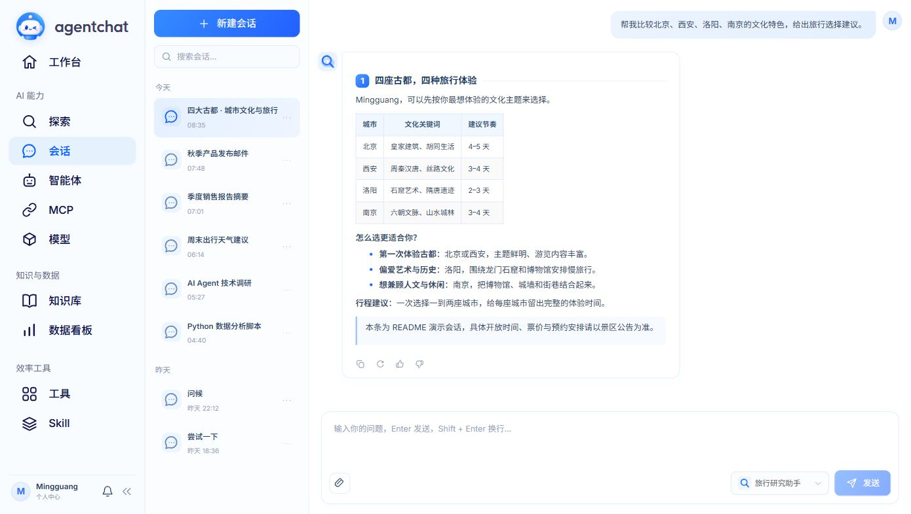
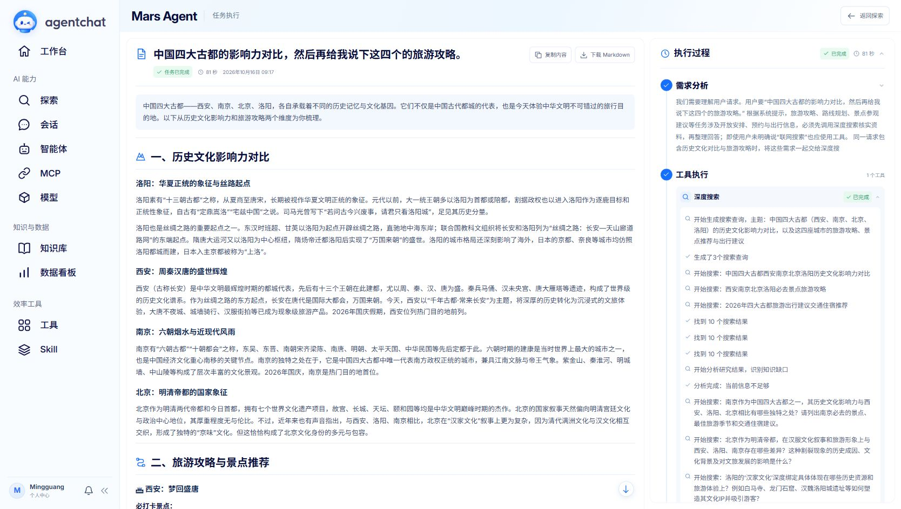

<div align='center'>
    
</div>

<div align="center">

<p align="center">
  
  
  
  
</p>

<p align="center">
  <b>一个基于大模型的现代化智能对话系统</b>
</p>

<p align="center">
  <a href="https://shy2593666979.github.io/agentchat-docs/%E5%BF%AB%E9%80%9F%E5%85%A5%E9%97%A8.html">快速开始</a> •
  <a href="https://shy2593666979.github.io/agentchat-docs/%E5%BC%80%E5%8F%91%E6%8C%87%E5%8D%97/%E7%8E%AF%E5%A2%83%E6%90%AD%E5%BB%BA.html">部署指南</a> •
  <a href="https://shy2593666979.github.io/agentchat-docs/">在线文档</a> •
  <a href="https://agentchat.cloud">在线体验</a> •
  <a href="https://github.com/Shy2593666979/agentchat-docs/blob/main/images/README.md">加入微信交流群🌟</a>
</p>

</div>

---

## 本次更新 · 2026.10.16

### 1. 全面更新界面与项目品牌

- 使用蓝色机器人 Logo 与小写 `agentchat` 字标，统一侧边栏、登录页和浏览器标签页的品牌展示。
- 调整工作台、探索、智能体、工具、Skill、MCP、模型、知识库及数据看板的页面样式，统一标题位置、字体、字重、间距和卡片布局。
- 优化三列页面的衔接，减少列间空隙；通知与个人账户入口统一放到侧边栏底部。
- 修复弹窗遮罩未覆盖侧边栏、个人菜单被遮挡和输入框边框重叠等问题，统一下拉菜单与卡片操作按钮的样式。

### 2. 优化智能体管理与能力展示

- 重新设计智能体卡片，调整图标、名称、简介、模型信息与操作按钮的布局。
- 在卡片中使用图标和数量展示工具、MCP、Skill 与知识库的绑定情况，数量为零时不显示。
- 优化智能体编辑入口与能力选择界面，支持管理内置智能体及默认工具、MCP、Skill。
- 统一工具、Skill 和知识库的卡片风格；知识库卡片支持直接点击进入，精简重复信息。

### 3. 改善会话阅读与附件体验

- 统一会话列表、聊天记录和输入框的布局，调整用户消息与 AI 回复的字体颜色、字号及留白。
- 回复气泡根据内容宽度收缩，减少短回复右侧的大块空白；精简消息顶部的重复智能体信息。
- 统一复制、重新回答、点赞与点踩图标，减少操作区与正文之间的割裂感。
- 优化发送前的附件展示和聊天记录中的附件卡片，让文件信息与消息内容保持一致的视觉风格。
- 智能体选择改为下拉入口，使用所选智能体绑定的模型、知识与工具。

### 4. 完善工具执行过程与 MCP 对话

- 调整工具调用过程的展示，区分等待、执行中、完成与失败状态，方便查看任务进展。
- MCP 对话沿用智能体会话的消息与输入框样式，并保留人机协同（HITL）确认交互。
- 模型选择按厂商组织，先展示厂商 Logo 与名称，再展开对应的模型列表。
- MCP 列表增加分页，精简卡片中的服务地址和重复操作；通过“自定义 MCP”按钮进入对话式创建流程。

### 5. 重整 Mars 任务执行与报告页面

- 重新布局执行过程与任务报告，适配不同工具的执行信息，精简输入区和重复的任务信息。
- 优化执行进度、过程展开与结果阅读体验，保留报告复制和 Markdown 下载入口。
- 修复最终结果重复拼接的问题，避免同一份报告在结尾再次输出。
- 调整旅游攻略与路线规划任务的提示词，要求先通过深度搜索核实资料，再整理回答。
- 修复 Markdown 流式排版时自动跟随中断的问题；用户主动滚动后可暂停跟随，便于阅读已有内容。

### 6. 完善模型展示与个人账户

- 新增模型展示名称字段 `show_model`，将界面名称与实际调用的模型标识分开，便于展示自定义名称。
- 补充和整理国内外模型厂商名称与 Logo，统一模型列表、智能体卡片和模型选择菜单中的展示。
- 默认用户头像改为用户名首字母圆形头像，保留自定义上传，移除随机头像与预设头像选择。

### 7. 支持 SQLite / MySQL 与轻量本地运行

- 数据库根据连接 URL 自动选择 SQLite 或 MySQL，统一同步、异步连接的配置与初始化。
- 常规配置与简易配置默认使用 SQLite，降低首次运行对外部数据库的依赖。
- 提供本地文件存储与内存缓存的简易运行方案，同时保留 MySQL、Redis 和对象存储的配置选项。
- 补充本地启动说明与配置文档，便于将本地前端连接到本地后端。

### 8. 更新项目截图与任务演示

- 替换 README 品牌封面与业务页面截图，移除旧版界面图片，展示当前项目的实际样式。
- 使用 **Mingguang** 演示账号展示会话、数据看板、智能体和多厂商模型配置，并注明示例数据的用途。
- 增加“四大古都影响力对比与旅游攻略”的任务演示，展示搜索工具调用、资料整理与报告生成过程。
- README 使用 GitHub 内嵌视频播放器，支持直接播放、拖动进度和全屏查看。

[查看任务视频](#探索任务演示) · [浏览页面截图](#当前界面)

完整内容见 [更新日志](docs/CHANGELOG.md)，轻量本地启动见 [简易配置](docs/simple-config.md)。

<details>
<summary>上一版本更新 · 2026-04-12</summary>

## 2026-04-12

### 1. 基于人机协同（HITL）的OpenAPI信息对话式MCP Server生成

- 支持将OpenAPI信息以人机协同方式进行对话式MCP Server生成。
- 在生成MCP Server的过程中，关键决策节点支持人工介入与确认，实现动态配置与实时交互。
- 提升了服务器的生成灵活性与系统可控性，让用户在自动化流程中保留充分的主动权。

### 2. 优化对话上下文管理
重构对话上下文管理策略，从简单的"最近5段对话"升级为智能三层记忆架构：
- 短期记忆 (Short-Term Memory): 保持最近3000 tokens以内的对话内容，确保即时上下文连贯
- 历史信息总结: 自动总结超过3000 tokens的历史对话，提取关键信息
- 长期记忆 (Long-Term Memory): 持久化记录用户偏好、习惯和重要信息，实现个性化对话体验

### 3. 修复依赖冲突问题
解决了多个依赖包版本冲突问题，特别是 Pydantic、LangChain、FastAPI 等核心库的兼容性问题，提升系统稳定性。

### 4. 优化首次启动体验
修复首次启动时缺少模型配置导致的错误，新增配置检查和友好提示，引导用户完成初始化配置，降低使用门槛。

</details>

---

<details>
<summary><b>历史版本更新日志 (2026-3-8)</b></summary>

### 1. 支持MiniO本地对象存储
现在支持OSS和MiniO两种对象存储方式，参考文档: [本地安装MiniO](docs/development/install_minio_win.md)，感谢提供Issue的朋友:
- @xiaoyan011016
- @shenmi888

### 2. 优化Docker直接部署项目
(1) 前版本docker部署经常会出现 agentchat-frontend 连不上 agentchat-backend 的网络失败情况，已经修复该bug
(2) 缺少Win系统下的一键部署脚本，目前已经加上 (start_win.bat)

### 3. 支持自定义工具
之前点击自定义工具是无事件，目前可通过上传 Swagger/OpenAPI 构建自己的工具。

### 4. 支持Skill
现已支持通过创建 Skill 绑定到智能体渐进式加载 Prompt 去教模型如何做事。

### 5. 优化页面样式
前版本中系统设置为空白，现在已经去除。

</details>

---

## 目录

- [一、项目简介](#一项目简介)
- [二、功能展示](#二功能展示)
- [三、重要版本说明](#三重要版本说明)
- [四、功能特性](#四功能特性)
- [五、技术栈](#五技术栈)
- [六、快速开始](#六快速开始)
- [七、高级部署指南](#七高级部署指南)
- [八、文档](#八文档)
- [九、许可证](#九许可证)

---

## 一、项目简介

AgentChat 是一个现代化的智能对话系统，基于大语言模型构建，提供了丰富的AI对话功能。系统采用前后端分离架构，支持多种AI模型、知识库检索、工具调用、MCP服务器集成等高级功能。

### 1. 核心亮点

- 智能Agent: 支持Sub-Agents协作，具备推理和决策能力
- 知识库检索: RAG技术实现精准知识检索和问答
- 工具生态: 内置多种实用工具，支持自定义扩展
- MCP集成: 支持Model Context Protocol服务器
- 现代界面: 基于Vue 3和Element Plus的美观UI
- 三层记忆: 短期保留上下文，历史自动总结，长期记录用户偏好
- 人机协同生成: 基于HITL对话式生成MCP Server，关键节点可人工介入
---

## 二、功能展示

### 探索任务演示

在探索页输入一个目标，查看任务执行过程与完整报告：

> 中国四大古都的影响力对比，给我做一份这四个城市的旅游攻略。

https://github.com/user-attachments/assets/640650f3-4134-452a-9d17-6f850dabe95f

从探索页发起任务，查看深度搜索、资料整理与报告生成的完整流程。演示视频经过剪辑，仅展示应用内容。

### 当前界面

以下使用 **Mingguang** 账号展示。会话、统计及多厂商模型配置为演示数据；展示模型未配置调用密钥，不代表已验证这些厂商的实际调用。

#### 会话与任务结果

会话历史、Markdown 回复与输入框保持统一；Mars 将报告与执行过程并排呈现。





#### 数据看板

查看模型调用、Token 用量、七日趋势与最近活动。


#### 模型服务

以六家厂商各一款模型展示名称、厂商图标及接口配置；`show_model` 与实际请求的模型标识分别管理。


#### 智能体与能力管理


<table>
<tr>
<td width="50%"><b>工具</b><br>管理内置工具与自定义能力。<br><a href="docs/media/tools.jpg"></a></td>
<td width="50%"><b>Skill</b><br>将可复用的操作知识组织成技能。<br><a href="docs/media/skills.jpg"></a></td>
</tr>
<tr>
<td width="50%"><b>MCP</b><br>连接外部工具与数据服务。<br><a href="docs/media/mcp.jpg"></a></td>
<td width="50%"><b>知识库</b><br>按主题管理知识空间。<br><a href="docs/media/knowledge.jpg"></a></td>
</tr>
</table>

<details>
<summary>查看登录页</summary>


</details>

## 三、重要版本说明

从 AgentChat v2.2.0 版本开始，LangChain 已升级至 1.0 版本。

<div align="center">

| 版本 | LangChain版本 | 兼容性 | 说明 |
|:---:|:---:|:---:|:---|
| v2.1.x 及以下 | 0.x | 旧版本 | 使用旧版LangChain API |
| v2.2.0+ | 1.0+ | 最新版本 | 重大更新，API变化较大 |

</div>

1. LangChain 1.0 引入了重大API变更。
2. 部分工具和Agent配置方式已更新。
3. 建议查看迁移指南了解详细变更。

---

## 四、功能特性

### 1. 核心功能模块

- AI对话引擎: 支持多模型生态、流式响应、上下文记忆、思考可视化。
- 智能Agent系统: 多Agent协作、任务自动化、工作流编排、目标导向。
- 知识库系统: 多格式支持、语义分块、向量检索、RAG问答。
- 工具生态: 内置10+实用工具，支持自定义上传与扩展。

### 2. 高级特性

- MCP服务器: 完整协议支持，运行时动态加载。
- 用户管理: 安全认证、细粒度权限控制、个性化配置。
- 系统架构: 前后端分离，Docker部署，异步高性能处理。

---

## 五、技术栈

- 后端: FastAPI, Python 3.12+, LangChain, SQLite / MySQL, 内存缓存 / Redis, ChromaDB.
- 前端: Vue 3.4+, Element Plus, Pinia, Vite 5, TypeScript.
- 部署: Docker, Docker Compose, Poetry, npm.

---

## 六、快速开始

### 1. 系统要求

- Python 3.12+
- Node.js 18+
- 默认本地方案：SQLite、内存缓存、本地文件存储
- MySQL、Redis、Docker 为按需选择的部署组件

### 2. 推荐：本地简易配置

先按 [简易配置指南](docs/simple-config.md) 配置模型密钥，再启动后端与前端。SQLite 无需额外安装，数据库文件自动保存在本地；搜索、邮件等外部工具仍需配置对应服务。

模型管理中的 `show_model` 是界面展示名称，`model` 是实际请求标识，两者可分别设置。

### 3. Docker一键部署

```bash
# 1. 克隆项目
git clone https://github.com/Shy2593666979/AgentChat.git
cd AgentChat

# 2. 编辑配置文件
vim docker/docker_config.yaml

# 3. 启动
cd docker
docker-compose up --build -d
````

### 4. 本地一键部署

克隆项目
```bash
git clone https://github.com/Shy2593666979/AgentChat.git

cd AgentChat
```


后端启动服务
```bash
cd src/backend

# 安装依赖
1. pip install -r requirements.txt

# 或者使用uv (更推荐)
1. pip install uv
2. uv sync 
```

前端启动服务
```bash
cd src/frontend

# 下载依赖
npm install
npm run dev
```

-----

## 七、高级部署指南

系统支持多种向量数据库（Milvus/ChromaDB）和搜索引擎（Elasticsearch）的配置。具体请参阅部署文档。

-----

## 八、文档

  - API文档: [AgentChat Document](docs/reference/agentchat.md)
  - 开发指南: 启动后端后访问 /docs 查看 Swagger 文档。
  - [Parallel Search MCP](docs/reference/parallel_search_mcp.md): 已登记在 `config/mcp_server.json` 中自动加载，无需 API Key（`config_enabled` 为 `false`），匿名端点有速率限制，需在 Agent 中显式绑定后才会启用。

-----

## 九、许可证

本项目采用 **[MIT License](LICENSE)** 开源许可证

*这意味着你可以自由使用、修改和分发本项目*


-----


## 十、感谢支持 AgentChat

<div align="center">

## 🌟 **感谢支持 AgentChat！**

### 如果这个项目对你有帮助，请给我们一个 ⭐️

*让更多的人发现这个项目，一起构建AI的未来！*

*Made with ❤ by the AgentChat Author MingGuang Tian*


<picture>
  <source
    media="(prefers-color-scheme: dark)"
    srcset="
      https://star-history.dera.page/svg?repos=Shy2593666979/AgentChat&type=Date&theme=dark
    "
  />
  <source
    media="(prefers-color-scheme: light)"
    srcset="
      https://star-history.dera.page/svg?repos=Shy2593666979/AgentChat&type=Date
    "
  />
  
</picture>

</div>
