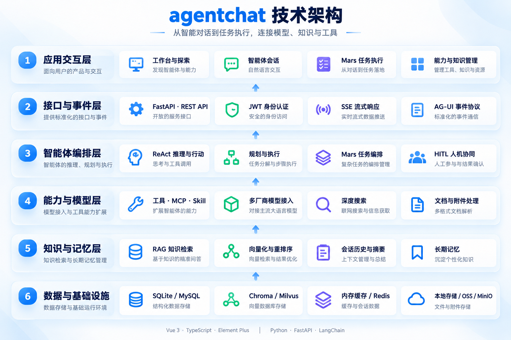
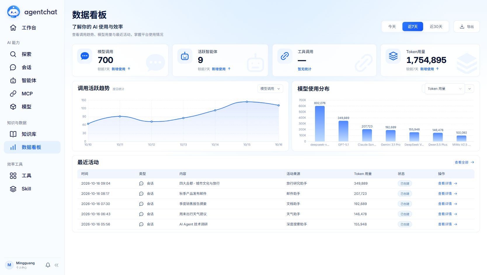
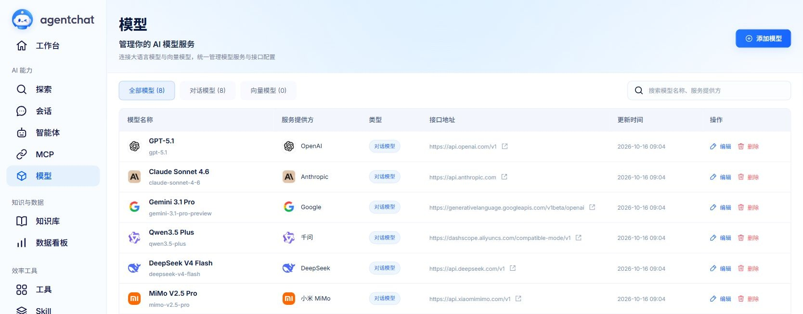
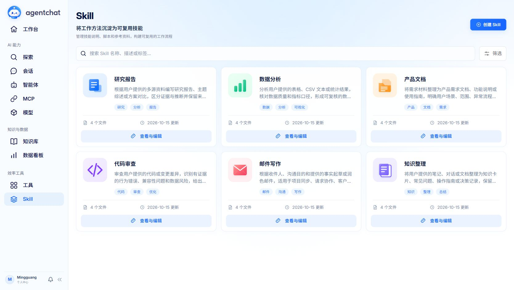
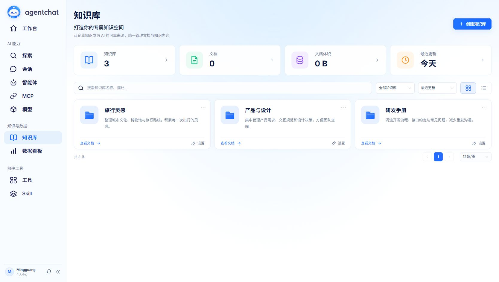
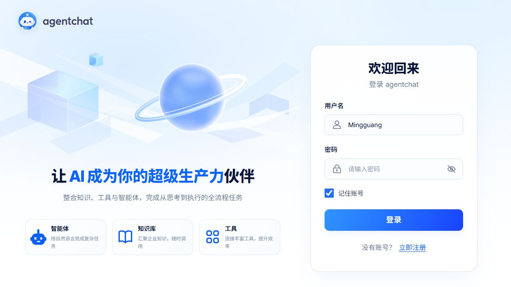

<div align='center'>
    
</div>

<div align="center">

<p align="center">
  
  
  
  
</p>

<p align="center">
  <b>连接模型、知识与工具的智能体应用平台</b>
</p>

<p align="center">
  <a href="#快速开始">快速开始</a> •
  <a href="#高级配置">部署指南</a> •
  <a href="https://shy2593666979.github.io/agentchat-docs/">在线文档</a> •
  <a href="https://agentchat.cloud">在线体验</a> •
  <a href="https://github.com/Shy2593666979/agentchat-docs/blob/main/images/README.md">加入微信交流群🌟</a>
</p>

</div>

---

[English](README_EN.md) · [更新日志](docs/CHANGELOG.md)

## 项目简介

agentchat 是一个前后端分离的智能体应用平台。你可以连接模型服务，为智能体绑定工具、Skill、MCP 和知识库，在会话中使用这些能力，也可以通过 Mars 发起搜索、研究和报告任务，查看执行过程与结果。

首次运行可以使用 SQLite、内存缓存、本地文件和 Chroma，无需额外部署 MySQL、Redis、MinIO 或 Milvus。需要外部数据库、缓存或对象存储时，再切换对应配置。

## 核心能力



| 能力 | 使用方式 |
| --- | --- |
| 灵活会话 | 在同一会话中切换智能体；根据首条问题异步生成 2–10 字话题标题 |
| 智能体 | 选择模型，配置提示词，组合工具、MCP、Skill 与知识库 |
| Mars 任务 | 从探索页发起任务，查看工具执行过程与 Markdown 报告 |
| 工具与 MCP | 使用内置工具、导入 OpenAPI，或连接 SSE / Streamable HTTP MCP 服务；支持对话式创建 MCP 与人工确认 |
| Skill | 启动时加载研究报告、数据分析、产品文档、代码审查、邮件写作、知识整理六类技能模板 |
| 知识库 | 上传资料、向量化并绑定到智能体，检索后重排；可按需启用全文检索 |
| 用户资源隔离 | 注册时获得独立的默认智能体、工具、Skill 和 MCP 副本，编辑不会影响其他用户 |
| 用量与日志 | 记录模型调用和会话 Token 用量，提供数据看板、请求追踪与工具耗时日志 |
| 流式协议 | 通过 AG-UI 适配层统一消息、工具执行和运行状态事件 |

模型服务和外部工具各自有配置要求。基础聊天可先配置一个对话模型；知识库需要可用的向量模型，部分工具还需要单独的 API Key。

本轮变化包括界面与品牌更新、会话改造、用户资源隔离、AG-UI、Token 统计、统一日志和 GitHub CI，完整记录见 [更新日志](docs/CHANGELOG.md)。

## 目录

- [功能展示](#功能展示)
- [快速开始](#快速开始)
- [首次使用](#首次使用)
- [高级配置](#高级配置)
- [开发与测试](#开发与测试)
- [文档导航](#文档导航)
- [许可证与支持](#许可证与支持)

## 功能展示

### 探索任务演示

在探索页输入一个目标，查看任务执行过程与完整报告：

> 中国四大古都的影响力对比，给我做一份这四个城市的旅游攻略。

https://github.com/user-attachments/assets/640650f3-4134-452a-9d17-6f850dabe95f

从探索页发起任务，查看深度搜索、资料整理与报告生成的完整流程。演示视频经过剪辑，仅展示应用内容。

### 当前界面

#### 数据看板

查看模型调用、Token 用量、七日趋势与最近活动。



#### 模型服务

以六家厂商各一款模型展示名称、厂商图标及接口配置；`show_model` 与实际请求的模型标识分别管理。



#### 智能体与能力管理


<table>
<tr>
<td width="50%"><b>工具</b><br>管理内置工具与自定义能力。<br><a href="docs/media/tools.jpg"></a></td>
<td width="50%"><b>Skill</b><br>将可复用的操作知识组织成技能。<br><a href="docs/media/skills.jpg"></a></td>
</tr>
<tr>
<td width="50%"><b>MCP</b><br>连接外部工具与数据服务。<br><a href="docs/media/mcp.jpg"></a></td>
<td width="50%"><b>知识库</b><br>按主题管理知识空间。<br><a href="docs/media/knowledge.jpg"></a></td>
</tr>
</table>

<details>
<summary>查看登录页</summary>



</details>

## 快速开始

### 1. 准备环境

- Git、Python 3.12、Node.js 22（与 CI 保持一致）。
- [uv](https://docs.astral.sh/uv/getting-started/installation/)：用于创建 Python 虚拟环境及安装锁定依赖。
- 一个可用的模型 API Key、接口地址和模型标识。以下使用 [DeepSeek Flash](https://api-docs.deepseek.com/zh-cn/) 的 `deepseek-flash` 作为示例。

以下从 `main` 主分支获取代码。在开始之前，确认终端中 `uv --version` 和 `node --version` 可执行。

### 2. 获取代码并安装后端依赖

```bash
git clone --branch main https://github.com/Shy2593666979/AgentChat.git
cd AgentChat/src/backend
uv sync --locked --python 3.12
```

### 3. 创建自己的配置

Windows PowerShell：

```powershell
Copy-Item agentchat/config.simple.yaml agentchat/config.local.simple.yaml
```

Linux / macOS：

```bash
cp agentchat/config.simple.yaml agentchat/config.local.simple.yaml
```

编辑 `src/backend/agentchat/config.local.simple.yaml` 中的对话模型：

```yaml
multi_models:
  chat_model:
    api_key: "填写你的 DeepSeek API Key"
    base_url: "https://api.deepseek.com"
    model_name: "deepseek-flash"
```

这里展示的是需要编辑的片段，文件中的其他设置保留。`config.local*.yaml` 已被 Git 忽略。DeepSeek 示例用于对话；知识库的向量和重排模型需要另行配置，不能直接复用 DeepSeek Key，见 [模型配置说明](docs/simple-config.md#模型继承与能力边界)。

### 4. 启动后端

仍在 `src/backend` 目录执行，并保持终端运行。

Windows PowerShell：

```powershell
$env:AGENTCHAT_CONFIG = "agentchat/config.local.simple.yaml"
uv run --locked uvicorn agentchat.main:app --host 127.0.0.1 --port 7860
```

Linux / macOS：

```bash
export AGENTCHAT_CONFIG=agentchat/config.local.simple.yaml
uv run --locked uvicorn agentchat.main:app --host 127.0.0.1 --port 7860
```

打开 [健康检查](http://127.0.0.1:7860/health)，应返回 `{"status":"OK"}`；接口文档位于 [Swagger UI](http://127.0.0.1:7860/docs)。这表示服务已启动，模型是否可调用还需要发送消息验证。

### 5. 启动前端

另开一个终端，从项目根目录执行：

```bash
cd src/frontend
npm ci
npm run dev -- --host 127.0.0.1 --port 8090 --strictPort
```

访问 [http://127.0.0.1:8090](http://127.0.0.1:8090)。前端开发服务器通过 `/api` 代理访问本机 `7860` 端口的后端。

后端地址不同时，在 `src/frontend/.env.local` 中设置 `VITE_API_BASE_URL=http://后端地址:端口`，然后重启前端。后端端口、启动参数与本地文件的访问地址也应保持一致，详见 [简易配置指南](docs/simple-config.md)。

## 首次使用

1. **注册并登录**：新账号会获得自己的默认智能体、工具、Skill 与 MCP 副本。知识库按需创建。
2. **确认模型**：配置文件中的 `chat_model` 用于系统默认模型；在模型服务页添加的模型可供智能体选择。展示名称与实际调用标识分别填写，真实调用以服务商要求的标识为准。
3. **开始会话**：选择一个智能体发送问题。同一会话可以切换智能体，话题标题会在后台生成，也可以手动修改。
4. **添加能力**：在智能体编辑页绑定需要的工具、MCP、Skill 或知识库。MCP 出现在列表中不等于已绑定到当前智能体；调用第三方服务前确认其地址和凭据可用。
5. **使用资料与任务**：需要检索资料时先上传到知识库并等待处理完成；需要搜索研究时可从探索页发起 Mars 任务。知识库依赖向量与重排模型，任务依赖实际选用的工具配置。
6. **查看用量**：数据看板展示调用与 Token 统计；统计依据模型返回的 usage，服务商未返回用量时可能不完整。

## 高级配置

简易配置沿用完整 YAML 结构，省略的参数使用默认值。详细说明见 [简易配置](docs/simple-config.md) 和 [后端文档](src/backend/README.md)。

| 需求 | 配置入口 |
| --- | --- |
| 切换 SQLite / MySQL | `database.url`，同步与异步驱动自动派生 |
| 使用 Redis | `redis.endpoint`；本地单进程可留空使用内存缓存 |
| 使用 MinIO / OSS | `storage.mode` 以及对应存储配置 |
| 分开设置模型 | `multi_models` 下的 `chat_model`、`tool_call_model`、`reasoning_model`、`embedding`、`rerank` 等 |
| 更换向量库或启用全文检索 | `rag.vector_db`、`rag.enable_elasticsearch` 及对应连接设置 |
| 添加默认 MCP / Skill 模板 | `agentchat/config/mcp_server.json`、`agentchat/config/default_skills.json` 与 `config/skills/` |
| 调整日志 | `log_level`；日志目录可通过 `AGENTCHAT_LOG_DIR` 指定 |

配置加载优先级为：代码显式传入路径 → `AGENTCHAT_CONFIG` → `agentchat/config.local.yaml` → `agentchat/config.yaml`。`config.local.simple.yaml` 需要通过环境变量指定，修改后重启后端。

已有的 [Docker 文件](docker/) 使用 MySQL、Redis、MinIO 和前端开发服务器的组合，与上述轻量本地方案不同。容器部署需要单独核对容器地址、配置与持久化目录；本次文档更新没有完成这套容器方案的运行验证。

## 开发与测试

后端，在 `src/backend` 执行：

```bash
uv sync --locked --group dev
uv run --locked pytest tests -q
```

前端，在 `src/frontend` 执行：

```bash
npm ci
npm run lint
npm run build
node --test tests/mars-task.test.cjs
```

安装前端依赖后，后端测试还会校验 Python AG-UI 事件与前端解析器的配合。需要外部服务的手动脚本放在 `src/backend/tests/manual`，默认不收集。

[GitHub CI](.github/workflows/ci.yml) 在推送 `main`、提交 PR 或手动触发时运行后端测试及前端类型检查、构建。它使用临时数据库和测试配置，无需真实模型密钥。`npm run build` 生成前端静态文件，不会自动部署应用。

## 文档导航

- [后端架构、接口与故障排查](src/backend/README.md)
- [简易配置与本地数据目录](docs/simple-config.md)
- [灵活会话与异步标题](docs/flexible-conversations.md)
- [用户资源隔离](docs/private-resources.md)
- [默认 Skill](docs/default-skills.md)
- [默认 MCP](docs/mcp-defaults.md) · [Parallel Search MCP](docs/reference/parallel_search_mcp.md)
- [AG-UI 流式协议](docs/ag-ui.md)
- [会话 Token 统计](docs/conversation-token-usage.md)
- [日志格式与追踪](docs/logging.md)
- [测试说明](src/backend/tests/README.md)
- [更新日志](docs/CHANGELOG.md)

## 许可证与支持

本项目采用 [MIT License](LICENSE)。

<div align="center">

## 🌟 **感谢支持 AgentChat！**

### 如果这个项目对你有帮助，请给我们一个 ⭐️

*让更多的人发现这个项目，一起构建AI的未来！*

*Made with ❤ by the AgentChat Author MingGuang Tian*


<picture>
  <source
    media="(prefers-color-scheme: dark)"
    srcset="
      https://star-history.dera.page/svg?repos=Shy2593666979/AgentChat&type=Date&theme=dark
    "
  />
  <source
    media="(prefers-color-scheme: light)"
    srcset="
      https://star-history.dera.page/svg?repos=Shy2593666979/AgentChat&type=Date
    "
  />
  
</picture>

</div>
